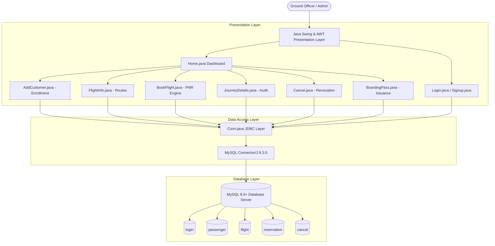

# ✈️ Airline Management System (AMS)

[](docs/PRD.md)
[](docs/ARCHITECTURE.md)
[](docs/MEMORY.md)
[](https://www.oracle.com/java/)
[](https://www.mysql.com/)

A modular desktop **Airline Management System** developed in **Java (Swing & AWT)** integrated with **MySQL Relational Database** via **JDBC**. Engineered for airport check-in agents, ground operations staff, and ticketing officers.

---

## 📚 Engineering & Design Documentation

For recruiters, architects, and technical interviewers, detailed engineering specifications are documented in the [`docs/`](docs/) directory:

- 📄 **[`docs/PRD.md`](docs/PRD.md)** — **Product Requirements Document:** Problem statement, target personas, core MVP functional scope, and non-functional requirements.
- 🏛️ **[`docs/ARCHITECTURE.md`](docs/ARCHITECTURE.md)** — **System Architecture:** 3-Tier architecture diagrams, technology stack rationale, end-to-end data flow sequences, and normalized ER schema.
- 🧠 **[`docs/MEMORY.md`](docs/MEMORY.md)** — **Project Memory & Roadmap:** Development timeline, task telemetry, Architectural Decision Records (ADRs), and future feature proposals.

---

## 🏛️ High-Level System Architecture



---

## 🌟 Core Functional Capabilities

- 🔐 **Staff Authentication & Registration:** Secure login screen with password verification plus a dedicated **"First Time User? Register / Sign Up"** workflow with automatic table provisioning.
- 📊 **Operations Command Dashboard:** High-contrast desktop dashboard featuring 6 rapid-access operational modules.
- 🛫 **Flight Route Directory:** Real-time lookup of active carriers, flight numbers, origin cities, and destination hubs.
- 👤 **Passenger Enrollment Engine:** Onboarding interface enforcing unique identification constraints (Aadhar/National ID).
- 🎟️ **Automated Reservation & PNR Engine:** Generates cryptographically randomized 6-digit PNRs and 4-digit Ticket IDs while matching origin-destination route pairs.
- 📋 **Journey Verification & Audit:** Real-time inspection of flight itineraries and traveler manifests by PNR.
- ❌ **Revocation & Cancellation Desk:** Handles ticket cancellation transactions with automated cancellation reference number (`CAN-XXXXX`) issuance.
- 🎫 **Electronic Boarding Pass Document:** Generates priority boarding documents with terminal allocation, gate assignment, seat designation, and simulated optical barcode.

---

## 🛠️ Technology Stack Breakdown

| Layer | Technology | Architectural Purpose |
| :--- | :--- | :--- |
| **Language Runtime** | Java SE (JDK 17+) | Core object-oriented business logic and JVM execution |
| **GUI Framework** | Java Swing & AWT | Native desktop windowing, event-driven controllers, responsive UI layouts |
| **Data Connectivity** | JDBC API | Low-latency binary socket communication with relational database |
| **Database Driver** | MySQL Connector/J 8.3.0 | Native JDBC type-4 driver |
| **Database Engine** | MySQL 8.0+ | Relational storage with foreign key constraints and ACID transaction support |
| **Build Tooling** | Maven & VS Code Java | Dependency lifecycle management and launch configurations |

---

## 📂 Project Structure

```text
airline-management-system/
├── docs/
│   ├── PRD.md                   # Product Requirements Document
│   ├── ARCHITECTURE.md          # System Architecture & Diagrams
│   └── MEMORY.md                # Project Memory, ADRs & Task Log
├── .vscode/
│   ├── launch.json              # 1-click VS Code launch configuration
│   └── settings.json            # Java classpath settings
├── legacy-swing/
│   └── src/
│       └── airlinemanagementsystem/
│           ├── Conn.java        # JDBC MySQL Connection Manager
│           ├── Login.java       # Main Entrypoint / Login UI
│           ├── Signup.java      # First-Time Staff Registration Form
│           ├── Home.java        # Operations Command Dashboard
│           ├── FlightInfo.java  # Route & Carrier Schedule Explorer
│           ├── AddCustomer.java # Passenger Enrollment Interface
│           ├── BookFlight.java  # PNR Generator & Seat Reservation
│           ├── JourneyDetails.java # PNR Itinerary & Audit Table
│           ├── Cancel.java      # Cancellation & Voucher Desk
│           └── BoardingPass.java# Electronic Boarding Document Generator
├── database.sql                 # Complete MySQL schema & baseline seed data
├── pom.xml                      # Maven build descriptor with MySQL Connector dependency
└── README.md                    # Project documentation
```

---

## 🚀 How to Run Locally

### 1. Database Setup
1. Open **MySQL Workbench** or command line client.
2. Execute the provided [`database.sql`](database.sql) script to provision tables and seed records:
   ```sql
   source database.sql;
   ```
3. Verify your MySQL credentials in `legacy-swing/src/airlinemanagementsystem/Conn.java`:
   ```java
   private static final String DB_USER = "root";
   private static final String DB_PASS = "your_mysql_password";
   ```

### 2. Run in VS Code
1. Open the project folder in **Visual Studio Code** (`File` > `Open Folder...`).
2. Ensure the **Extension Pack for Java** (Microsoft) is installed.
3. Open `legacy-swing/src/airlinemanagementsystem/Login.java`.
4. Press **`F5`** or click **Run**.
5. Log in with existing credentials (`admin` / `admin123`) or click **"✨ First Time User? Register / Sign Up"** to create a new officer account!

---

## 📄 License & Author
- **Author:** [Shree Singhwal](https://github.com/Shree-Singhwal)
- **License:** Open-source prototype developed for portfolio and educational demonstration.
